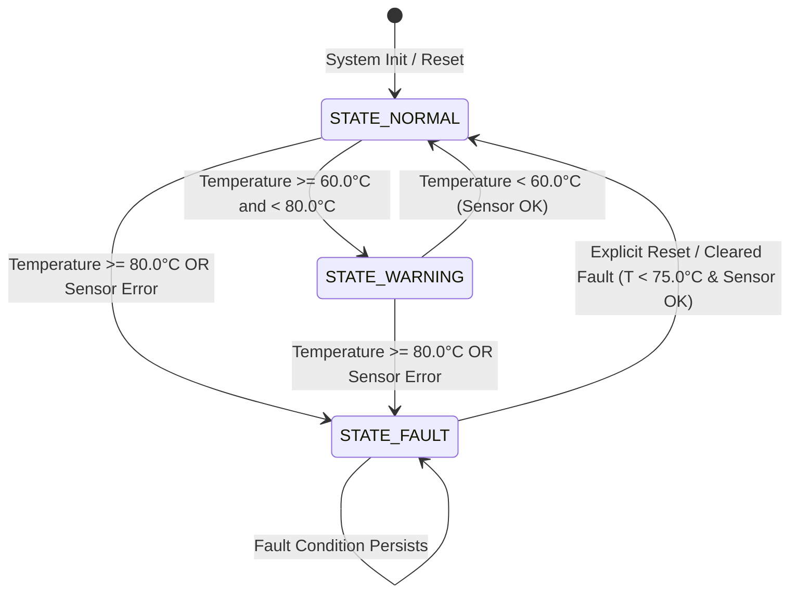

# Architecture & Design Specification: Sensor Fault Controller

**Project:** Project 1 — Embedded Sensor Monitoring & Fault Controller  
**Document:** Architecture & Component Design  

---

## 1. Architectural Pattern: Layered Modular Design

To mirror industry-standard automotive/aerospace embedded software (such as AUTOSAR classic architectures), the system strictly separates the core control logic from hardware/application interfaces:

```text
+-------------------------------------------------------------+
|                     Application Layer                       |
|           (src/main.c / Automated Test Scripts)             |
|   - Parses command-line inputs / telemetry streams          |
|   - Formats human-readable & JSON-parseable console output  |
|   - Translates OS return codes                              |
+-------------------------------------------------------------+
                              |
                              | Pure C Data Structures (SensorReading_t, ControllerOutput_t)
                              v
+-------------------------------------------------------------+
|                 Controller Engine Layer                     |
|                (src/sensor_controller.c)                    |
|   - Zero I/O, Zero Printf, Zero OS syscalls                 |
|   - Defensive Input Validation & Sanity Checks              |
|   - Deterministic State Machine (FSM) Evaluation            |
|   - Hysteresis & Fault Latching Policy                      |
+-------------------------------------------------------------+
                              ^
                              |
+-------------------------------------------------------------+
|                   Interface Contracts                       |
|               (include/sensor_controller.h)                 |
|   - Domain Enums: SystemState_t, SensorStatus_t, FaultCode_t|
|   - Structures: SensorReading_t, ControllerOutput_t         |
|   - Threshold Constants: TEMP_WARN_MIN, TEMP_FAULT_MIN      |
+-------------------------------------------------------------+
```

---

## 2. Finite State Machine (FSM) Specification

### 2.1 State Definitions
- **`STATE_NORMAL`**: Default operational state. Temperature is strictly below $60.0^\circ\text{C}$ and sensor is healthy.
- **`STATE_WARNING`**: Elevated thermal state ($60.0^\circ\text{C} \le T \le 79.9^\circ\text{C}$). System alerts operators/supervisors; cooling mechanisms would engage.
- **`STATE_FAULT`**: Safe state triggered when $T \ge 80.0^\circ\text{C}$ OR sensor fails validation. System shuts down or enters fail-safe fallback.

### 2.2 State Transition Diagram (Mermaid)



### 2.3 State Transition Table

| Current State | Input Condition | Next State | Fault Code | Action / Note |
| :--- | :--- | :--- | :--- | :--- |
| `STATE_NORMAL` | $T < 60.0^\circ\text{C}$ & Sensor OK | `STATE_NORMAL` | `FAULT_NONE` | Continuous monitoring |
| `STATE_NORMAL` | $60.0^\circ\text{C} \le T < 80.0^\circ\text{C}$ & Sensor OK | `STATE_WARNING` | `FAULT_NONE` | Warning alert trigger |
| `STATE_NORMAL` | $T \ge 80.0^\circ\text{C}$ | `STATE_FAULT` | `FAULT_OVER_TEMP` | Over-temp shutdown |
| `STATE_NORMAL` | Sensor Invalid / Comm Error | `STATE_FAULT` | `FAULT_SENSOR_*` | Sensor fail-safe |
| `STATE_WARNING` | $T < 60.0^\circ\text{C}$ & Sensor OK | `STATE_NORMAL` | `FAULT_NONE` | Thermal recovery |
| `STATE_WARNING` | $60.0^\circ\text{C} \le T < 80.0^\circ\text{C}$ & Sensor OK | `STATE_WARNING` | `FAULT_NONE` | Thermal condition persists |
| `STATE_WARNING` | $T \ge 80.0^\circ\text{C}$ | `STATE_FAULT` | `FAULT_OVER_TEMP` | Over-temp escalation |
| `STATE_FAULT` | Fault unlatched, $T < 75.0^\circ\text{C}$ & Sensor OK | `STATE_NORMAL` | `FAULT_NONE` | System recovered |
| `STATE_FAULT` | Fault condition remains active | `STATE_FAULT` | Preserved | Latch safety state |

---

## 3. Data Contracts & Type Definitions

The module will define clean, explicit scalar types without ambiguity:

```c
typedef enum {
    SENSOR_OK = 0,
    SENSOR_ERR_DISCONNECTED,
    SENSOR_ERR_COMM_TIMEOUT,
    SENSOR_ERR_OUT_OF_BOUNDS,
    SENSOR_ERR_INVALID_DATA
} SensorStatus_t;

typedef enum {
    STATE_NORMAL = 0,
    STATE_WARNING,
    STATE_FAULT
} SystemState_t;

typedef enum {
    FAULT_NONE = 0,
    FAULT_OVER_TEMP,
    FAULT_SENSOR_UNDER_RANGE,
    FAULT_SENSOR_OVER_RANGE,
    FAULT_SENSOR_DISCONNECTED,
    FAULT_SENSOR_COMM_ERROR,
    FAULT_SENSOR_INVALID_DATA
} FaultCode_t;

typedef struct {
    float temperature_c;
    SensorStatus_t status;
} SensorReading_t;

typedef struct {
    SystemState_t current_state;
    FaultCode_t active_fault;
    float filtered_temperature;
} ControllerOutput_t;
```

---

## 4. Input Validation & Defensive Engineering

1. **Floating Point Sanity (`isnan`, `isinf`):** Prevents arithmetic invalidity from bypassing comparison operators.
2. **Physical Boundary Guards:** Temperatures below $-40.0^\circ\text{C}$ or above $+150.0^\circ\text{C}$ are flagged as sensor hardware faults (`FAULT_SENSOR_UNDER_RANGE` / `FAULT_SENSOR_OVER_RANGE`).
3. **Pointer Null Checks:** Functions accepting pointers verify `ptr != NULL` defensively before dereferencing, returning error codes rather than crashing.

---

## 5. Host Simulation & Integration Contract for Project 2

For seamless validation by Python in Project 2:
- Executable exit code `0`: Successful execution (State: NORMAL or WARNING).
- Executable exit code `2`: State FAULT encountered.
- Executable exit code `1`: Command-line syntax error / invalid CLI arguments.
- Standard Output format:
  ```text
  STATE: NORMAL | TEMP: 25.40 C | FAULT: NONE
  STATE: WARNING | TEMP: 65.20 C | FAULT: NONE
  STATE: FAULT | TEMP: 85.10 C | FAULT: OVER_TEMP
  ```
This enables the Python test framework to validate both standard exit codes and regex-parsed telemetry.
